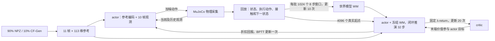

# 从原版 OmniContact 到搬箱 V3：数据、策略和训练的完整对照

本文比较 Unitree G1 的**搬箱 MLP**。基线选官方 OmniContact 的 Isaac Lab 训练任务 `OmniContact`。V3 在同一个仓库里增加独立的 `carrywm` 训练入口，复用官方搬箱数据、G1 场景和 CF-Gen 规划器。核心变化是把全身参考交给新的 CF-Track，用 MuJoCo 的真实轨迹训练可微世界模型，再让策略通过这个模型学习怎样搬箱。[官方基线](https://github.com/Ingrid789/OmniContact/tree/19cde38364a5b48e47348b270c895eabe2ba3ad9) · [V3 训练入口](../carrywm/train_v3.py) · [最新 actor 实现提交](https://github.com/Solivaman/OmniContact2SuperMimic/commit/a9626f2cec005008dd8543c7c7ed9416445ecc38)

| 一轮训练里发生什么 | 官方 CF-Track MLP | 本仓库搬箱 V3 |
|---|---|---|
| 给策略什么目标 | 跟踪示范中的稀疏 contact flow。官方 sim2sim 也可用 CF-Gen 在线规划 | 90% 主回合取 NPZ，10% 由官方 CF-Gen 规划，两路都具有接触流和全身姿态 |
| 谁产生训练数据 | Isaac Lab 的并行物理环境产生 PPO rollout | CPU MuJoCo 提供物理监督。GPU 上的 WM 预测机器人、自由箱子及接触 |
| 什么更新策略 | PPO 通过采样动作的概率比、优势与裁剪目标更新 | Actor 在冻结 WM 中连续决策 32 步，通过折扣奖励和末端价值反传 |
| 4096 代表什么 | 默认物理场景数，每个环境取 24 步 | 从回放有放回抽取的 4096 个想象起点。当前物理 runner 每轮采 32 个转移 |
| 部署时执行什么 | 官方 MLP／ONNX 及其观测适配器 | 新的参考与历史适配器、训练好的 MLP actor、关节 PD。WM 和 critic 供训练使用 |



## 原版 OmniContact 如何完成搬箱

CF-Gen 负责“接下来双手、双脚、躯干和箱子应该去哪里，哪些时刻应该接触”。搬箱生成器根据机器人和箱子的初始位姿、箱子尺寸和目标落点，分阶段规划姿态，结合正逆运动学生成参考轨迹。CF-Track 负责“机器人此刻应该给哪 29 个关节发什么控制量”，每个控制周期都根据参考和机器人观测重新算一次动作。训练数据给出的关节姿态、生成器给出的参考关节姿态、策略真正发出的控制命令是三个不同的量。[官方搬箱生成器](https://github.com/Ingrid789/OmniContact_sim2sim/blob/1cf9ddd4067cbe5710b1f475e96f9c69f88055e2/policy/omnicontact/CFgen_meta2_carrybox.py) · [官方轨迹字段](https://github.com/Ingrid789/OmniContact_sim2sim/blob/1cf9ddd4067cbe5710b1f475e96f9c69f88055e2/policy/omnicontact/CFgen_builder.py#L232-L291)

这里把官方训练任务 `OmniContact` 的 MLP 配置作为基线。它在 Isaac Lab 里运行 Unitree G1 和物体，每个环境连续采 24 步，再用 PPO 更新策略。环境配置默认 4096 个实例，控制频率 50 Hz。普通 MLP 把未来参考与实际观测历史拼接，actor 隐藏层为 512、256、128，使用 ELU，输出 29 维高斯策略的动作均值。critic 可见额外的仿真信息。官方另有 AMP 和 Transformer 任务，可独立选用。V3 使用自建 MuJoCo 采集器及可微 WM，actor 通过预测动力学反传，因而官方的 4096 个物理环境、V3 每轮的 4096 条想象轨迹分别衡量真实采样与模型内训练预算。[官方任务注册](https://github.com/Ingrid789/OmniContact/blob/19cde38364a5b48e47348b270c895eabe2ba3ad9/source/omnicontact/omnicontact/tasks/omnicontact/__init__.py) · [官方 PPO 配置](https://github.com/Ingrid789/OmniContact/blob/19cde38364a5b48e47348b270c895eabe2ba3ad9/source/omnicontact/omnicontact/tasks/omnicontact/agents/rsl_rl_ppo_cfg.py) · [官方场景与控制时间步](https://github.com/Ingrid789/OmniContact/blob/19cde38364a5b48e47348b270c895eabe2ba3ad9/source/omnicontact/omnicontact/tasks/omnicontact/env_cfg.py#L525-L542)

| actor 输入或输出 | 官方 CF-Track MLP | 本项目 V3 搬箱 MLP |
|---|---|---|
| 未来参考 | 11 帧，每帧五个部位的位置和朝向共 45 维，另有 4 个接触标记，共 539 维 | 保留这一组信息，再加每帧 64 维全身参考，得到 `[11,113]`，展平后 1243 维 |
| 当前及过去的观测 | 5 帧，每帧 141 维，共 705 维 | 9 帧历史加当前帧，共 `[10,141]`、1410 维 |
| 策略如何使用参考 | 普通 MLP 同时读取 539 + 705 = 1244 个输入 | 先把 1243 维参考编码为 32 维 `z_t`，再把 `z_t` 与 1410 维历史拼成 1442 维 decoder 输入 |
| 每次动作 | 输出一个 29 维关节控制向量 | 同样一次输出一个 29 维向量。在 WM 内连续调用 32 次，后一步读取前一步预测出的状态和新观测 |

官方张量把全部帧的连杆位姿目标和接触标记分别展平再拼接。V3 按帧打包，更换了关节排序与部分连杆定义，也改变了坐标处理的具体实现。因此即使两边都称“49 维 contact flow”，也应分别使用各自的数据适配器和策略权重。官方用手部橡胶连杆、踝 roll 连杆作为跟踪点。V3 选择 MuJoCo 手掌与踝 pitch 连杆，使 NPZ 与 CF-Gen 的训练参考对齐。[官方参考构造](https://github.com/Ingrid789/OmniContact/blob/19cde38364a5b48e47348b270c895eabe2ba3ad9/source/omnicontact/omnicontact/tasks/omnicontact/mdp/observations.py#L160-L208) · [官方部署时的输入拼接](https://github.com/Ingrid789/OmniContact_sim2sim/blob/1cf9ddd4067cbe5710b1f475e96f9c69f88055e2/policy/omnicontact/OmniContact.py#L417-L458) · [V3 的连杆和关节映射](../carrywm/data.py)

## 两种参考如何进入同一个 actor

训练使用官方数据集 `npz_clips/box/case1_carry` 的 623 个 50 Hz 增强片段，它们在本次实验服务器上放在 `assets/data/box/case1_carry`。原始完整动作另存于 `npz/box/case1_carry`，共 210 条。数据适配器按原始动作分组，再以固定种子划分训练、验证和测试集，避免同一来源的不同箱子尺寸或切片跨集合。当前代码按文件名提取来源，使用划分种子 5302。这批文件实测训练集 512 段（156 组），验证集 53 段（19 组），测试集 58 段（19 组）。每次开始普通训练回合时，以 90% 概率直接读取演示，以 10% 概率调用官方 CF-Gen。这个比例作用在回合来源上，各回合长短不同，回放中的逐步样本占比会浮动。掉箱后的恢复参考另行统计。[数据划分与适配](../carrywm/data.py) · [回合来源选择](../carrywm/sim.py)

- **演示参考。** 从 NPZ 读五个跟踪连杆、骨盆和箱子的世界位姿、四个接触标记及 29 维关节角与速度。关节角与速度从 Isaac Lab 顺序映射到 MuJoCo 顺序。参考使用原始数据，训练动作仍有探索噪声。
- **生成参考。** `CfGenCarryBox.generate` 接收场景初始骨盆与箱子位姿、尺寸和目标位置。目标位置使用这条演示的最终箱子位置，演示中的中间姿态、关节轨迹和接触标签都不会作为规划器输入。规划器生成五个跟踪部位与箱子、骨盆的参考位姿、接触标记、29 个关节角 `dof_pos` 和阶段 `ref_phase`。V3 对完整关节序列按 0.02 秒间隔差分得到速度，再抽离散前瞻帧。规划阶段编号保存在环境里，策略输入不含阶段编号。V3 的分阶段动力学误差按实测接触和事件另外划分。训练生成普通回合时，仅在目的地水平坐标加标准差 5 毫米的高斯扰动，并裁剪到箱子可得到桌面支撑的范围。CF-Gen 算法本身保持固定，学习发生在 WM、actor 和 critic。[原始输出字段](https://github.com/Ingrid789/OmniContact_sim2sim/blob/1cf9ddd4067cbe5710b1f475e96f9c69f88055e2/policy/omnicontact/CFgen_builder.py#L269-L291) · [关节速度与生成参考打包](../carrywm/data.py) · [目标扰动与物理复位](../carrywm/sim.py)

两条路径先形成**每帧 111 维的世界坐标记录**。依次为五个连杆位姿 35、接触标记 4、关节角 29、关节速度 29、骨盆位姿 7、箱子位姿 7。位姿由三维位置与四元数构成。箱子和骨盆的完整世界位姿可供复位与奖励计算。随后 `CarryGeometry.reference` 用当前真实或 WM 预测的机器人状态，把记录转成 actor 读取的 **113 维参考**。[V3 原始帧](../carrywm/data.py) · [参考坐标变换](../carrywm/model.py)

| 策略每个参考帧的字段 | 维度 | 输入的物理含义 |
|---|---:|---|
| 五个部位的参考位姿 | 45 | 左右手掌、躯干、左右踝。每个部位含相对当前躯干原点的位置 3 维、相对当前躯干航向的旋转 6 维。相对位置也用该航向坐标系表达 |
| 四个计划接触标记 | 4 | 左脚、右脚、左手、右手在该参考时刻的目标接触状态 |
| 参考关节角和速度 | 58 | 29 个参考关节角和 29 个参考关节速度 |
| 参考骨盆相对朝向 | 6 | 当前骨盆完整朝向到参考骨盆朝向的相对旋转，取旋转矩阵前两列 |

例如当前在第 100 帧，读取第 100、101、102、103、104、108、112、116、124、132、150 帧。超过片尾的索引取最后一帧。11 帧中最远的参考在 1 秒之后。每帧的 49 维接触流和 64 维全身参考共同进入 encoder。每个预测步都随机器人新姿态重新计算相对坐标。参考箱子位姿参与奖励。当前真实或预测的箱子位置、朝向和尺寸所决定的几何外形进入策略的观测历史。[离散窗口和片尾处理](../carrywm/replay.py) · [坐标、奖励与观测](../carrywm/model.py)

单帧的 **141 维观测**依次包括五个末端点在躯干系的位置 15、骨盆局部角速度 3、投影重力 3、相对默认姿态的关节角 29、关节速度 29、上一步动作 29、箱子相对位置 3、箱子相对朝向 6、八个箱角的相对位置 24。五个末端点是双手、双踝和头部传感器 `mid360_link`。启动一个回合时，首帧填满历史。随后每一步去掉最旧帧，追加当前帧。[历史更新](../carrywm/train.py) · [观测分量](../carrywm/model.py)

默认 actor encoder 为 `1243 → 2048 → 1024 → 512 → 256 → 32 → tanh`，decoder 为 `1442 → 2048 → 1024 → 512 → 256 → 29`。隐藏层用 LayerNorm 和 GELU，参考和历史各自归一化。32 维向量由搬箱策略端到端学习。输出 `a_t` 表示归一化的关节目标偏移，MuJoCo 计算 `目标关节角 = 默认角 + scale × a_t`，按 PD 控制和力矩限幅执行 4 个物理子步。一个参考角、一条动作指令、一个执行后的实际关节角都可在同一时刻取不同值。[策略定义](../carrywm/model.py) · [动作执行](../carrywm/sim.py)

## 一条真实动作怎样变成世界模型的监督

以“从起点桌拿箱子、放到终点桌”为例。OmniContact 原版 CF-Track 在 Isaac Lab／PhysX 里执行动作。其训练场景默认开 4096 个环境，物理以 200 Hz 步进，每 4 个子步更新一次控制。V3 复用搬箱场景的 G1、自由箱子、两张桌子、PD 参数和 50 Hz 控制周期。正式训练的真实转移来自 CPU MuJoCo。GPU 上的 WM 负责另一批可反传的想象轨迹。每轮的 4096 条 actor 轨迹从真实回放中抽取起点，可重复抽样。

1. 机器人收到 29 个归一化动作。每个关节的目标为默认关节角加动作乘以该关节的缩放。每个 5 ms 子步用当前关节角和关节速度重新计算 PD 力矩，再按执行器上限裁剪。
2. MuJoCo 执行 4 个子步，并刷新末端位姿和接触。箱子受接触力、重力和惯性作用，可脱手、落地或靠桌面支撑。参考箱子的位置只用于跟踪与评分。每种箱子尺寸用对应的碰撞形状和对角惯量，两个桌面位置取自该段数据。16 维物理上下文随转移一起保存。
3. 回放存入当前状态、实际执行的带噪动作、下一状态和 6 个接触标签。监督 WM 的 8 步序列全部出自同一段连续物理经历。跌倒、掉箱或重置后的新片段有独立边界。原版 Isaac Lab 配置中的摩擦、关节增益、质心和外推力等训练扰动不能自动等同于这套 MuJoCo 设置。V3 的场景几何、CF-Gen 目标扰动与动作探索应分别记录。

代码见 [原版环境设定](https://github.com/Ingrid789/OmniContact/blob/19cde38364a5b48e47348b270c895eabe2ba3ad9/source/omnicontact/omnicontact/tasks/omnicontact/env_cfg.py)、[V3 物理环境](../carrywm/sim.py) 与 [回放采样](../carrywm/replay.py)。

## 从随机策略到第一轮更新

1. 新训练初始化 actor、WM、critic、三个 Adam、归一化统计与容量为 65536 个转移的回放池。三个网络的初始权重独立于官方策略。真实采集将标准差 0.1 的独立高斯噪声加到归一化动作上，再限幅到 `[-10,10]`。想象与验证使用确定性的 actor。
2. 先由当前随机初始化的 actor 在 MuJoCo 中执行 4096 步，用真实观测和执行动作更新归一化统计。预热时三个优化器均为零次更新。回放须出现同片段连续 8 步的有效窗口，随后进入正式更新。4096 是本项目单采集器的预算。SuperMimic 原版在并行环境中用回放窗口是否足够控制学习启动。[SuperMimic 原版预热](https://github.com/HybridRobotics/supermimic/blob/abc124c/src/supermimic/runners/supermimic_runner.py#L598-L697)
3. 每轮再收 32 个真实转移，然后依次执行 WM 的 10 次更新、actor 的 1 次更新、critic 的 20 次更新。回放按有效窗口数在各片段间均匀抽起点，可重复抽样。一次掉箱恢复会新开片段，回放不会把重置前后拼成 WM 的一个监督窗口。[采集及调度](../carrywm/train.py) · [分段回放](../carrywm/replay.py)
4. 对正式的 6000 轮，真实训练预算为 `4096 + 6000 × 32 = 196096` 个转移。验证另采轨迹。每轮最多有 `4096 × 32 = 131072` 个想象转移，终止掩码决定多少步参与损失。这两个预算分别反映物理交互量和模型计算量。

官方 PPO 的默认迭代使用 5 遍、每遍 4 个小批，初始学习率 0.001，概率比裁剪范围参数 0.2，并使用熵奖励。V3 去掉这条 PPO 概率比更新路径。下面的三个损失给出了新策略学习的全部梯度来源。[官方超参数](https://github.com/Ingrid789/OmniContact/blob/19cde38364a5b48e47348b270c895eabe2ba3ad9/source/omnicontact/omnicontact/tasks/omnicontact/agents/rsl_rl_ppo_cfg.py) · [V3 损失与优化器](../carrywm/train.py)

## 一轮里三个网络各学什么

以机器人准备从桌上抬起箱子的第 100 帧为例。Actor 根据“该往哪里搬”和“刚才身体怎样动”给出这一拍的 29 个关节指令。世界模型（WM）推演指令执行 20 毫秒后身体和箱子会怎样动。奖励函数给这一拍打分。Critic 估计从新姿态继续搬下去还能拿到多少折扣奖励。三个网络各用一个 Adam 优化器，学习率均为 $2\times10^{-4}$，每次更新前将该网络的全局梯度范数裁剪到 1。[网络定义](../carrywm/model.py) · [训练入口](../carrywm/train.py) · [V3 更新顺序](../carrywm/train_v3.py)

| 网络 | 默认输入 → 隐藏层 → 输出 | 可训练参数 | 每轮更新 |
|---|---|---:|---|
| WM | 129 → 2048 → 2048 → 2048 → 三个独立线性头，分别为 35、6、6 维 | 8,767,535 | 10 次，每次抽 1024 个连续 8 步窗口 |
| Actor encoder | 1243 → 2048 → 1024 → 512 → 256 → 32 → tanh | 5,317,920 | 与 decoder 合计更新 1 次 |
| Actor decoder | 1442 → 2048 → 1024 → 512 → 256 → 29 | 5,724,701 | 与 encoder 共享这一批 4096 条轨迹 |
| Critic | 1343 → 512 → 256 → 1 | 821,249 | 4 个小批 × 5 遍，共 20 次 |

每个隐藏层依次执行全连接、LayerNorm、GELU。Actor 合计有 11,042,621 个可训练参数。参考和观测使用各自的运行均值、方差归一化，WM 也对拼接后的输入做归一化。这些统计量随数据更新，表中的参数量只统计通过梯度训练的权重和偏置。[网络定义](../carrywm/model.py)

### WM 从真实仿真学习动力学

WM 每次读取当前状态 $s_t$（84）、实际执行的动作 $a_t$（29）及场景参数 $\xi$（16），共 129 维。状态中的 84 个数包括机器人骨盆与关节的位置和姿态（36）、速度（35），以及箱子的位置和姿态（7）、速度（6）。场景参数依次为箱子三轴半尺寸（3）、质量（1）、对角惯量（3）、摩擦参数（3）和两张桌子的位置（6）。[状态与场景参数](../carrywm/sim.py)

共享主干输出 2048 维特征。机器人头预测根部世界线速度增量（3）、局部角速度增量（3）与各关节速度增量（29）。箱子头预测世界线速度增量（3）和局部角速度增量（3）。接触头输出六个二元分类的 logits，前四个对应左脚、右脚、左手、右手与箱子接触，后两个对应左右脚支撑。综合起来，三个头共有 **41 个速度增量和 6 个接触 logits**。经过积分后，调用者拿到新的 84 维状态与 6 个接触 logits。[WM 前向传播](../carrywm/model.py)

一个控制周期 $\Delta t=0.02$ 秒，包含四个 5 毫秒物理子步。设速度头本步输出为 $\Delta v$，实现取 $v_{t+1}=v_t+\Delta v$，平移及关节位置取 $p_{t+1}=p_t+\Delta t\,(v_t+\tfrac58\Delta v)$。在每个物理子步以恒加速度做半隐式积分时，四个子步使用的速度增量分数平均为 $(1/4+2/4+3/4+4/4)/4=5/8$。旋转同样取修正后的角速度，用旋转增量更新、归一化四元数。机器人各连杆位姿随后由 G1 的可微正运动学计算。[积分和正运动学](../carrywm/model.py)

每个监督窗口包含同一真实回合内的 **9 帧状态、8 个实际执行动作、8 帧实测接触标签、1 组场景参数**。例如用 MuJoCo 第 100 帧状态初始化，预测第 101 帧。再用预测的 101 帧状态和回放中真实执行的第 101 帧动作预测 102 帧，如此直到 108 帧。每个预测结果都与同一时刻的 MuJoCo 真值对齐。每轮独立抽 10 批，每批完成一次 8 步反传和一次更新，下一批用更新后的 WM。

$$
L_{\rm WM}=\frac18\sum_{j=1}^{8}\left[\frac{1}{10}\sum_{g=1}^{10}
  \operatorname{mean}\!\left((e_{g,j}/\sigma_g)^2\right)
  +\operatorname{BCEWithLogits}(\ell_j,c_j)\right].
$$

前项给十组物理误差分别求均方再取平均，后项是六个接触标签的平均二元交叉熵。平移及速度取分量差，旋转取相对旋转的夹角。各组尺度是训练超参数，数值越小，相同绝对误差受到的惩罚越重。[监督损失](../carrywm/model.py) · [8 步更新](../carrywm/train.py)

| 误差组 | 骨盆位置 | 骨盆旋转 | 关节角 | 根线速度 | 根角速度 | 关节速度 | 箱子位置 | 箱子旋转 | 箱子线速度 | 箱子角速度 |
|---|---:|---:|---:|---:|---:|---:|---:|---:|---:|---:|
| 尺度 $\sigma_g$ | 0.08 m | 0.20 rad | 0.15 rad | 0.75 m/s | 1.5 rad/s | 3 rad/s | 0.04 m | 0.15 rad | 0.5 m/s | 1 rad/s |

### Actor 在冻结的 WM 里学控制

一个起点包括真实状态、上一动作、最近 10 帧观测、后续参考和场景参数。先从回放读取真实起点。第一个动作和后续 31 个动作都由冻结的 WM 推演，每一步都用新的预测状态更新观测、重新构造参考并再次决策。32 步共覆盖 0.64 秒。Actor 每个起点准备 83 个连续的原始参考帧，以便第 32 步末的价值估计仍能读取最远的未来目标。[起点采样](../carrywm/replay.py) · [闭环展开](../carrywm/train.py)

设 $r_j$ 为想象中第 $j$ 个动作产生的奖励，$c_j$ 为完成该步后能否继续的 0/1 标志，$m_0=1$，$m_{j+1}=m_jc_j$。令 $V$ 为 critic，$\gamma=0.99$。Actor 最大化从 4096 个起点出发的平均折扣回报，即最小化

$$
L_{\rm actor}=-\frac{1}{4096}\sum_{b=1}^{4096}
\left[\sum_{j=0}^{31}\gamma^j m_{b,j}r_{b,j}
 +\gamma^{32}m_{b,32}V(\hat s_{b,32},g_{b,32},\xi_b)\right].
$$

例如第 100 帧的手臂指令会改变 WM 预测的第 101 帧箱子状态，改变第 102 帧观测与动作，最终影响第 105 帧的手箱位置奖励。BPTT 沿这条链回到第 100 帧的 encoder 和 decoder。更新 actor 时，WM 与 critic 权重固定，但 WM 对动作、末端价值对状态的导数均保留。接触奖励使用 sigmoid 后的软概率，可以反传。终止采用布尔判定，梯度不会穿过判定阈值。[策略梯度路径](../carrywm/train.py) · [V3 actor 更新](../carrywm/v3.py)

当前 V3 默认一次处理 4096 条轨迹。为节省反传所需显存，仅对 actor encoder 启用激活重算，反传时用同一输入再算一次这段 MLP。真实 MuJoCo 采集、策略评估与导出路径均直接计算。若本次 actor 累积梯度时遇到 CUDA 显存不足，训练器清空尚未应用的 actor 梯度，再用较小的物理分块累积同一批 4096 条轨迹的梯度，完成后统一裁剪并更新一次。日志中的 actor/microbatches 和 actor/checkpoint_encoder 给出当轮实际路径。[激活重算](../carrywm/model.py) · [分块回退](../carrywm/v3.py)

### Critic 学习后续折扣回报

Critic 拼接当前状态 84 维、该时刻的 11 帧目标 1243 维和场景参数 16 维，输入共 1343 维，输出一个标量。每轮复用 actor 刚才生成的至多 $4096\times32=131072$ 个状态转移。用**本轮更新前**的 critic 计算各状态的价值。设 $G_{32}=V_{\rm old}(\hat s_{32},g_{32},\xi)$，从后向前构造 $\lambda$-return，取 $\lambda=0.95$。

$$
G_j=r_j+\gamma c_j\Big[(1-\lambda)V_{\rm old}(\hat s_{j+1},g_{j+1},\xi)+\lambda G_{j+1}\Big].
$$

假如第 104 帧的动作导致终止，该步 $c_j=0$，所以 $G_j=r_j$。更早几步仍能通过递推收到这次失败的影响。固定整批 $G_j$，筛选所有 $m_j=1$ 的有效步，打乱并等分成四个小批（大小最多相差 1），各自最小化 $\operatorname{mean}[(V_\psi-G_j)^2]$。按相同目标重新打乱训练 5 遍，共计 **20 次**参数更新。想象状态、目标和回报都从 actor 的计算图分离，critic 的这 20 次反传只更新自己的参数。日志中的 actor/return 是想象回报，critic/loss 是价值回归误差，搬箱是否成功要看 MuJoCo 中的实际执行结果。[目标递推](../carrywm/train.py) · [固定目标和 5 遍更新](../carrywm/v3.py)

## 奖励、掉箱恢复与评估

### 接触信号怎样进入奖励

参考流中的四个接触标记依次表示左脚、右脚、左手、右手是否应碰到**箱子**。因此“左脚落地站稳”与“左脚碰箱子”是两个不同通道。V3 在 MuJoCo 中用碰撞对和接触力构造标签，再单独记录两个脚的受力标记。

| 通道 | 真实仿真如何判断 | 用途 |
| --- | --- | --- |
| 左脚与箱、右脚与箱 | 分别累加踝部与箱子间的世界系接触力，合力大小大于 0 N | 对照参考接触、监督 WM |
| 左手与箱、右手与箱 | 分别累加腕部与箱子间的世界系接触力，合力大小大于 5 N | 对照参考接触、监督 WM、辨认抓起和脱手 |
| 左脚受力、右脚受力 | 分别累加该踝部与所有碰撞体的接触力，合力大小大于 1 N | 监督 WM、为滑脚惩罚加权 |

原版使用 Isaac Lab 过滤后的脚／腕相对于物体的接触传感器，在传感器输出各项上检查力阈值。V3 对 MuJoCo 碰撞对求合力，沿用脚 0 N、手 5 N 的阈值。不同引擎、碰撞几何和求和方式可能给出不同标签。真实支撑事件还分别检查箱子是否接触地面、起点桌、终点桌。这三个布尔值用于物理评价。WM 的接触头只有上述 6 个通道，因而在想象训练中使用可微的接触概率和近似掉箱判据。

### 保留哪些奖励，哪些量需要近似

对于同一个搬箱控制步，V3 将下列 15 个加权分量各乘 0.02 秒，再求和。跟踪项大多以误差平方出现在负指数中，误差越小时该项越接近其权重。这里的位置误差单位为米，旋转误差单位为弧度。

| 奖励组 | 分量及配置 |
| --- | --- |
| 机器人跟踪 | 躯干锚点位置和旋转各 0.2，尺度 0.3／0.4。对齐水平朝向后的身体位置和旋转各 0.2，尺度 0.3／0.4。双手全局位置和旋转各 0.4，尺度 0.3／0.4 |
| 箱子与抓持 | 箱子全局位置和旋转各 1.0，尺度均为 0.3。手相对箱子的位置与角度各 0.4，尺度均为 0.3，按参考手箱距离调整约束强度 |
| 接触匹配 | 权重 1.0，取四个手脚与箱接触标记的均方误差，再取负指数。物理日志使用实测标签，想象使用 WM 给出的概率 |
| 正则化 | 相邻动作差平方和乘 −0.1。肘腕力矩平方和乘 −0.005。超出软关节限位的幅度乘 −10。左右脚的水平速度按受力标记加权后乘 −0.1 |

原版奖励读 Isaac Lab 的刚体状态、反馈力矩和脚速度。V3 用可微 FK 从关节状态还原身体，用控制步起点的 PD 指令估计力矩，用相邻控制步的足部位置差估计水平速度。另加掉箱事件惩罚，默认扣 1.0，该项单独扣除，不乘 0.02。一个箱子短暂符合参考姿态可以获得正的跟踪奖励，整段搬运是否成功还要单独判定。代码见 [原版奖励配置与权重](https://github.com/Ingrid789/OmniContact/blob/19cde38364a5b48e47348b270c895eabe2ba3ad9/source/omnicontact/omnicontact/tasks/omnicontact/env_cfg.py#L388-L486)、[V3 奖励计算](../carrywm/model.py) 与 [事件扣分](../carrywm/train.py)。

### 箱子掉了，怎样结束或重新抓

**真实 MuJoCo 轨迹。** 箱子刚开始就放在起点桌上，单纯接触桌面不触发“掉箱”。有手接触、箱子同时脱离地面和两张桌面、相对起点上升超过 2.5 cm 或水平移动超过 10 cm，这些条件连续满足两帧才记为已经搬起。以后继续独立检查如下事件。

| 事件 | 物理判据及后续动作 |
| --- | --- |
| 成功 | 已搬起，箱子由终点要求的表面支撑（按目标箱底高度选择地面或终点桌），箱心距目标小于 20 cm，双手已松开，线速度小于 0.1 m/s、角速度小于 0.2 rad/s。连续满足 5 帧即成功，约 0.10 秒 |
| 掉箱 | 松手落地且比初始高度低超过 8 cm，或已搬起后连续至少 3 帧无手接触且箱子得到地面／桌面支撑。还要求箱体已稳定，并且离目标至少 20 cm 或支撑面错误 |
| 跌倒和超时 | 骨盆高度低于 0.30 m 或骨盆自身竖轴与世界竖轴的点积小于 0.35，记为跌倒。到参考片段最后一帧且未发生上述终止事件，记为超时 |
| 尝试恢复 | 掉箱时机器人仍站立，且当前段来自正常任务，下一次重置时尝试原地恢复一次。CF-Gen 接收实际骨盆、箱子位姿及原目标，求新的参考。检查首个双手抓握参考帧，左右指垫各距相应目标抓点至多 5 cm 才接受。通过后沿用实际物理状态，另开 recovery 片段并重置历史。无法生成、没有双手抓握帧或误差过大则开始新任务 |

**WM 想象轨迹。** 训练时只掌握模型预测，无法直接查询桌面碰撞对。若参考两手接触标记的平均值大于 0.5，而预测两手接触概率的平均值小于 0.5，连续至少 3 步且预测箱高低于当帧参考 15 cm，便扣掉箱惩罚并关掉该样本后续回报。预测骨盆或箱子的高度相对参考偏离超过 0.5 m，以及用完剩余参考，也会停止累计。连续的跟踪奖励可通过 WM 反向传播，布尔终止判据以掩码控制后续回报。

**两套原始方法的区别。** OmniContact 的基础 Isaac Lab 环境设 10 秒时限，另检查锚点、五个指定末端或箱子的参考高度误差是否超过 0.5 m。SuperMimic 的原始人体跟踪 WM 根据参考锚点误差生成平滑终止概率。V3 的实测“成功／掉箱”和 WM 内的想象终止各服务于自己的用途。来源见 [OmniContact 原版终止配置](https://github.com/Ingrid789/OmniContact/blob/19cde38364a5b48e47348b270c895eabe2ba3ad9/source/omnicontact/omnicontact/tasks/omnicontact/env_cfg.py#L489-L545)、[SuperMimic 想象终止概率](https://github.com/HybridRobotics/supermimic/blob/abc124c/src/supermimic/envs/world_model_env.py#L201-L219)、[V3 物理事件与恢复](../carrywm/sim.py) 与 [V3 想象回报](../carrywm/train.py)。

### 怎样判断真的学会搬箱

- **看执行策略。** 在独立的验证动作上实际运行 MuJoCo，验证时使用 actor 直接给出的动作，关掉探索噪声。正式配置每 250 轮评一次，分别以 NPZ 和 CF-Gen 各启动 3 个主任务。成功率、掉箱率按各自已结束的片段计数，恢复片段另列。3 个主任务每成功 1 个，成功率就变化约 33 个百分点。
- **看 WM 的长时预测。** 取验证时实际执行的同一串动作，分别递推 1、8、32 步，对照 MuJoCo 终点的箱子位置和旋转、骨盆位置和旋转、关节角误差及接触正确率。另记录“箱子始终停在起点”的位置误差，便于识别仅靠箱子静止就能预测准的场景。每种时长每片段最多取 128 个窗口，可包含终止帧，禁止跨重置。按空手、持箱、打滑、落地统计有效窗口数，分阶段聚合时按样本数加权。
- **看数据边界。** 按源动作组划分训练、验证、测试，变尺寸和同动作的切段留在同一集合。周期性训练日志使用验证集。独立测试集和真机结果需要另行执行。WM 想象存活率、物理仿真搬箱成功率与真机搬箱成功率应分别报告。

实现见 [验证入口](../carrywm/train.py)、[动力学评估与聚合](../carrywm/validation.py) 和 [数据划分](../carrywm/data.py)。

## 仓库沿革以及 AMP 的位置

个人仓库的可追溯基线是与官方训练仓库一致的提交 `19cde38`。当时已包含 `rsl_rl/`、Isaac Lab 任务注册、PPO、对抗运动先验 AMP、Transformer、读取专家运动数据与导出 ONNX 的代码。上游说明里的 “local additions” 指 OmniContact 作者相对 RSL-RL v2.3.3 添加的内容。项目提交 `bd5e790` 引入独立的 `carrywm/`、V2 的数据/模型/训练/验证/导出以及测试。`de8eb1f` 加入 V3 调度、从零预热和相应测试。在这条提交链上，官方 Isaac Lab 任务及原有 RSL-RL 算法仍有各自入口。[官方 RSL-RL 来源](https://github.com/Ingrid789/OmniContact/blob/19cde38364a5b48e47348b270c895eabe2ba3ad9/rsl_rl/UPSTREAM.md) · [V2 提交](https://github.com/Solivaman/OmniContact2SuperMimic/commit/bd5e790) · [V3 提交](https://github.com/Solivaman/OmniContact2SuperMimic/commit/de8eb1f)

官方 `OmniContact-AMP` 任务使用专家运动和策略运动训练判别器，以对抗运动先验奖励辅助 PPO。当前命令 `python -m carrywm.train_v3` 实例化 `LearnerV3`，只为 WM、actor、critic 建立三个 Adam 优化器。V3 的优化目标由动力学监督、可微搬箱回报和价值回归构成。V3 的 BF16 自动混合精度是计算精度选项，与“对抗运动先验”的 AMP 缩写含义不同。V2 代码允许调用官方 ONNX 教师采集初始回放，V3 正式实验从随机策略开始自行采集。[官方 AMP 配置](https://github.com/Ingrid789/OmniContact/blob/19cde38364a5b48e47348b270c895eabe2ba3ad9/source/omnicontact/omnicontact/tasks/omnicontact/agents/amp_rsl_rl_cfg.py) · [V3 入口](../carrywm/train_v3.py) · [优化器及采集器](../carrywm/train.py)

### 要改哪一段代码

| 问题 | 文件和入口 |
|---|---|
| 新数据该怎样映射到关节、参考和历史窗口？ | [data.py](../carrywm/data.py) 的 `load_demo`、`generate_clip`，以及 [model.py](../carrywm/model.py) 的 `CarryGeometry.reference`、`observation` |
| 真实箱子、接触和恢复在哪实现？ | [sim.py](../carrywm/sim.py) 的 `CarryEnv.reset`、`step`、`_contact`、`_try_recovery` |
| 哪些数据可以被采成 8 步或 32 步？ | [replay.py](../carrywm/replay.py) 的 `Replay.wm` 和 `Replay.actor`。后者取真实起点与参考，后续物理状态在 WM 中预测 |
| 网络宽度、状态积分、FK 和奖励在哪修改？ | [model.py](../carrywm/model.py) 的 `Actor`、`Critic`、`WorldModel`、`CarryGeometry`、`world_loss` |
| 更新顺序、冻结、预热、检查点在哪？ | [train.py](../carrywm/train.py) 的 `Collector`、`Learner._rollout` 和 `train`，[train_v3.py](../carrywm/train_v3.py) 的 V3 配置及 10 批 WM 调度，[v3.py](../carrywm/v3.py) 的 `LearnerV3.policy_update` |
| 怎样核验动力学、训练显存和部署策略？ | [validation.py](../carrywm/validation.py)、[monitor.py](../carrywm/monitor.py)、[export.py](../carrywm/export.py) 和 [V3 梯度与更新次数测试](../tests/test_v3.py) |

## 如何复现、接续和读取结果

在仓库根目录运行。实测环境为 Python 3.11、PyTorch 2.7 CUDA、MuJoCo 3.4，数据适配与规划器另需 NumPy、SciPy、PyYAML 及官方 sim2sim 依赖。下载官方 sim2sim 场景、规划器及机器人网格，并在 Hugging Face 取得数据集访问权限，下载 `npz_clips/box/case1_carry`。下面两个路径指向外部资源，第三个变量为本次实验的输出目录。[官方 sim2sim 修订](https://github.com/Ingrid789/OmniContact_sim2sim/tree/1cf9ddd4067cbe5710b1f475e96f9c69f88055e2) · [官方数据集](https://huggingface.co/datasets/lightcone02/OmniContact-Dataset) · [训练环境说明](carry-wm-v2.md)

```bash
export CARRY_SIM_ROOT=/path/to/OmniContact_sim2sim
export SIM2SIM_ROOT="$CARRY_SIM_ROOT"
export CARRY_DATA=/path/to/OmniContact-Dataset/npz_clips/box/case1_carry
RUN=outputs/carry-v3

python -m pytest -q tests/test_data_carry.py tests/test_model_v2.py tests/test_train_v2.py tests/test_v3.py
python -m carrywm.monitor --output-dir "$RUN" --gpu 0 --interval 2 -- \
  python -u -m carrywm.train_v3 --sim-root "$CARRY_SIM_ROOT" --motion-dir "$CARRY_DATA" \
  --output-dir "$RUN" --iterations 6000 --precision bf16 --seed 42 \
  --warmup-steps 4096 --no-warmup-teacher --wm-pretrain 0 --collect-steps 32 \
  --wm-batch-size 1024 --batch-size 4096 --actor-microbatch 4096 --checkpoint-encoder \
  --critic-chunk 32768 --save-every 50 --log-every 5 --eval-every 250 --eval-episodes 3
```

- **接续训练。** 在同一条 train 命令后加 `--resume "$RUN/latest.pt"`。`latest.pt` 原子写入，包含全局轮数、三个模型及优化器、回放、随机数状态与累计用时。接续时物理环境另起一个回合，学习进度按检查点延续。早期 V3 两组 2048 训练出的检查点也可用整批配置接续。重现旧调度时改用 `--actor-microbatch 2048 --no-checkpoint-encoder`。
- **看日志。** `metrics.jsonl` 记录每阶段耗时、实际物理步数、各优化器更新数、验证结果。`actor/microbatch_size`、`actor/microbatches` 和 `actor/checkpoint_encoder` 可检验实际执行路径。`gpu-*.csv/json` 区分训练进程占用、整卡显存、GPU 忙碌率与本次进程墙钟时间。`summary.json` 在训练结束后给出累计训练用时。中途暂停或独立基准所用时间单列。[监测器](../carrywm/monitor.py)
- **导出。** 执行 `python -m carrywm.export "$RUN/latest.pt" "$RUN/actor.pt"`。导出器保留 actor 和归一化统计，生成 TorchScript，并核验 batch 1 和 4 与训练端输出的一致性。部署端提供相同顺序、坐标系的 `[B,11,113]` 参考及 `[B,10,141]` 历史，输出 `[B,29]` 的归一化 PD 命令。[导出代码](../carrywm/export.py)
- **比较效果。** 同一数据划分、种子、物理采样预算下，用 `--goal-mode flow` 屏蔽新增 64 维，再比较验证成功率与达到相同成功率的用时。编码器和解码器首层宽度可通过 `--encoder-width`、`--decoder-width` 做对照。正式默认均为 2048。

## 单批 4096 的实际代价与收益

2026-11-22 在同一张 RTX 3090（24 GiB）上，从同一个 V3 第 400 轮检查点分别启动两种配置。每种配置均先运行一轮预热，再测四轮。逐轮匹配模型和优化器初值、回放和随机种子。每轮包含新物理片段的 32 步采集、十批 WM 更新、32 步完整 actor 展开及 critic 的 20 次更新。表中耗时取中位数，显存取 PyTorch 记录的测量轮最大值。每次均核验 Adam 的增量为 10、1、20，并检查实际分块，防止 OOM 回退影响比较。

| Actor 计算方式 | 采集 | WM | Actor + critic | 整轮 | 峰值已分配 / 已预留 |
|---|---:|---:|---:|---:|---:|
| 两组 2048，累积梯度 | 1.62 s | 1.97 s | 4.54 s | 8.12 s | 13.21 / 14.28 GiB |
| 一组 4096，encoder 激活重算 | 1.61 s | 1.95 s | 2.54 s | 6.14 s | 19.35 / 20.11 GiB |

同样的工作量下，整轮耗时降低约 24.4%，actor 和 critic 合计耗时降低约 44.0%。两条轨迹批处理路径在 BF16 下可能有舍入差异。在固定分块、256 条完整 32 步的对照中，单独切换 encoder 重算，所有 actor 梯度、critic 目标及总回报的最大差异为零。该对照评估计算速度与显存。判断是否改善搬箱能力需要相同条件下的任务成功率。

**物理环境并行是另一项实验。** 当前 runner 每轮从一个 CPU MuJoCo 环境采 32 步。在这台服务器的固定动作短测中，单进程约 348 个真实转移/秒，4 个独立进程合计约 1264 个/秒。短测未含 GPU 策略推理、进程间传输和完整训练。后续可用 4 个持久环境各采 8 步、保留各自的 10 帧历史和回放段，再按整轮时间比较。若 4096 个环境每轮各走一步，真实预算即变成每轮 4096 个转移，是当前的 128 倍。若各走 32 步，则是 131072 个真实转移。当前发布版使用单物理采集器。
